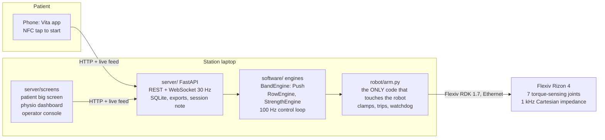

# Vita: a standard robot arm, turned into a rehab station

**Leukerbad Robot Carnival hackathon, 14 to 16 November 2026. Track 4: Elderly Care and Rehabilitation.**

Vita is software that turns an off-the-shelf, force-sensing robot arm (here a Flexiv Rizon 4) into a station for arm rehabilitation. The arm acts as an elastic band whose strength the patient picks on their phone; it counts every repetition and measures how far and how hard the patient pushes. A physiotherapist sees every repetition remotely.

Built in 48 hours by a team of five.

| | |
|---|---|
| Website | https://vitarehab.org |
| Patient app (hosted demo, simulated) | https://app.vitarehab.org |
| Pitch deck | `demo/pitch-deck/vita-pitch-deck.html` |
| Status | Research prototype, team-tested only. Not a medical device. |

---

## Start here

| If you want | Open |
|---|---|
| The pitch | `demo/pitch-deck/vita-pitch-deck.html` (double-click) |
| The technical hand-in document | `demo/hand-in-document-docs/hand-in-document.pdf` |
| The safety layer | [`robot/arm.py`](robot/arm.py) and [`robot/README.md`](robot/README.md) |
| How the exercises work | [`software/simple.py`](software/simple.py) and [`software/EXERCISES.md`](software/EXERCISES.md) |
| The API and screens | [`server/README.md`](server/README.md) and [`server/API.md`](server/API.md) |
| Engineering notes from the real arm | [`docs/BRINGUP_FINDINGS.md`](docs/BRINGUP_FINDINGS.md) and [`docs/MOTION_TEST.md`](docs/MOTION_TEST.md) |

---

## What runs today

| | On the real arm | In simulation |
|---|---|---|
| **Push** at 4 resistance levels (Light, Medium, Firm, Strong) | Yes: 10/10 reps counted at each level, smooth return | Yes |
| **Row** (pull towards you) at 4 levels | Yes: passed real-arm checks; automatic move to the far end and back with no stops | Yes, 57 dedicated tests + soak |
| **Strength test** (3 timed pushes against a held arm) | Yes: passed real-arm checks; untouched peak 1.6 N, nothing moves | Yes |
| Tap-to-start with an NFC tag on the station | Yes | Yes |
| Live rep counter, force bar and 3D twin on the phone | Yes | Yes |
| Physio dashboard, session note, exports | Yes | Yes |

---

## Architecture



- **One process on the station laptop.** The phone, the big screen and the physio dashboard all talk to the same local server. Nothing needs the internet, so a venue Wi-Fi failure cannot stop a session.
- **The robot does the fast loop.** The Rizon runs its own 1 kHz Cartesian impedance controller. Our 100 Hz loop only decides where the spring is anchored and how stiff it is. Python never closes a force loop.
- **One interface for real and simulated arms.** `robot/arm.py` (real) and `software/sim_arm.py` (simulated, with friction, sensor offset, drift, noise and stiffness latency) expose the same methods, so the engine, server and app were built and tested before the arm was ever connected.

## How the "elastic band" works

The patient holds the end of the arm and pushes along a straight 30 cm line.

1. The arm is told to behave as a **spring**: stiff across the line (soft walls keep the hand on track) and, along the line, a stiffness chosen so the patient feels the level's force.
2. The spring's anchor sits a fixed distance behind the hand, so the resistance stays near constant through the push instead of growing with distance.
3. **Stiffness is set once per set** (ramped over 0.5 s on a level change). Only the anchor moves. This is what made it smooth on the real arm.
4. **Reps are counted from position alone**, with hysteresis: out past 20 cm, counted when back within 5 cm. No guessing whether a hand is present.
5. At the end of a set, a "hands off" countdown, then **one continuous move back to the start** at 5 cm/s.

## Measured on the real arm (Push, 15 November)

| Level | Target | Reps counted | Mean force pushing out | Spread (sd) |
|---|---|---|---|---|
| 1 Light | 10 N | 4 of 4 | 10.9 N | 1.7 N |
| 2 Medium | 15 N | 10 of 10 | 19.1 N | 1.7 N |
| 3 Firm | 20 N | 10 of 10 | 25.0 N | 2.3 N |
| 4 Strong | 28 N | 10 of 10 | 31.2 N | 3.4 N |

- Return to start: **0.045 to 0.050 m/s with zero stops**, five runs.
- Straight-line tracking along the 30 cm line: **within 0.3 mm**, back to start within **0.09 mm**.
- Empty-handle reading after zeroing: **0.04 N**.
- Staged test of a raised force profile: held **50 to 54 N for 8 s**, reached **62 N** twice, no arm fault, highest joint load **46%** of its limit.
- Readings above target grow with hand speed (the arm's own damping, about 50 to 143 N per m/s by level), which is why the demo uses slow, steady pushes.

## Safety by construction

All limits live in `robot/arm.py`, below everything else, so no caller can override them.

| Layer | Value |
|---|---|
| Spring pull bound | stiffness clamp 600 N/m × anchor clamp 5 cm = **30 N** maximum commanded pull |
| Commanded speed | 0.15 m/s, acceleration 0.5 m/s², passed on every command |
| Trips to a soft hold | hand speed over 0.40 m/s, force over 40 N, hand 2 cm outside the workspace box |
| Workspace box | ±35 cm along the line, ±10 cm across and up, around the start pose |
| Watchdog | no command for 0.2 s holds the arm |
| Robot contact limit | 30 N (SetMaxContactWrench) |
| Moves the arm makes by itself | only after a 3 s "hands off" countdown, never while the handle reads over 6 N, aborted on a 10 N change |
| Human | a named e-stop holder for every session; `robot/RUNBOOK.md`, `robot/SAFETY.md` |

## What the real arm taught us (and how we fixed it)

| Problem on the real robot | Cause | Fix |
|---|---|---|
| Laptop could ping the arm but not control it | Remote Mode not enabled; RDK version must match robot software (v3.9.3 ↔ flexivrdk 1.7.0) | Elements Studio run in WSL, Remote Mode set to Ethernet, pinned RDK |
| 16 to 26 N reading with nothing touching | Constant joint-torque offset (shoulder, about 6 Nm) after joint moves; this Rizon 4 has no wrist sensor | Zero with `ZeroFTSensor` at the start pose before every set: 15.5 N → under 0.5 N |
| "10 N" level pulled 25 N | The robot applies stiffness along the **tool** axes, not the base axes; the 500 N/m wall landed on the push direction | Stiffness mapped onto the correct tool axis with an 11° correction; measured 200 N/m as commanded |
| Return to start stopped and started | A soft spring dragged against about 4.5 N of friction (stick-slip) | Anchor walks back at a steady 5 cm/s; measured zero stops |
| Freedrive hit a singularity | Arm stretched almost straight | Start pose chosen by joint-space moves, every joint at least 29° from its limit |
| Rep counting missed real reps, counted phantom ones | Rep start depended on detecting a hand from a noisy force signal | Reps counted from position only |

## Built simulation-first

- `software/sim_arm.py` reproduces the real arm's quirks found on the robot: Coulomb friction, empty-handle reading that varies with pose, sensor drift and noise, stiffness latency.
- About **900 automated tests** (about 10,000 lines) across `robot/`, `software/` and `server/`, including soak tests that run dozens of full sessions through the real HTTP API on the simulated arm with random patients.
- Scripts in `server/hw/` brought the real arm up step by step: read-only probe, joint moves with automatic stops, zeroing, drift check along the line, path trace, empty-handle engine runs.

## Run it without a robot

```bash
python -m venv .venv && .venv/bin/pip install -r server/requirements.txt -r software/requirements.txt
```
```bash
.venv/bin/python -m server.run --mock
```
Then open `http://127.0.0.1:8000/app/` (patient app), `/screens/patient.html` (big screen), `/screens/physio.html` (physio dashboard) and `/screens/operator.html` (operator console). Everything in mock mode is labelled SIMULATED.

On the station laptop wired to the arm: `python -m server.run --robot --lan` (Push only by default; `--with-row-strength` adds Row and the strength test). Cold-start steps are in `robot/RUNBOOK.md`.

## Repository map

| Folder | What | Owner |
|---|---|---|
| `robot/` | `arm.py` safety layer over the Flexiv RDK, config, run book, safety checks, tuning | Kian |
| `software/` | Engines (Push, Row, Strength; the earlier adaptive engine), simulated arm and patient, metrics, rep detection | Shiv, Shyan |
| `server/` | API, live feed, storage, exports, session note, screens, real-arm bring-up scripts (`server/hw/`) | Shyan |
| `demo/` | Patient app, website, pitch deck | Mat, Gio |
| `docs/` | Engineering notes: bringing the real arm up, the first motion tests, the exercise map, NFC set-up | everyone |


## Status and honest limits

- Research prototype. Tested by the team on a bare flange and a printed handle; not used with patients. A product like this is a medical device and needs certification first.
- The physio dashboard's history is simulated and labelled so; today's sessions are real.
- Strength readings are capped at about 30 N by the safety limits on this arm.
- Row and the strength test passed their real-arm checks on 16 November; they have had fewer hours of use than Push.

**Team:** Shyan Shah, Shiv, Kian, Mat (Matvey), Gio van Belle.

## Licence

MIT, see [LICENSE](LICENSE).
